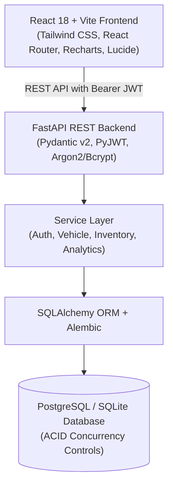

# Car Dealership Inventory Management System - Architecture & Implementation Plan

## 1. Executive Summary & Architecture Overview
This document establishes the architecture, design specifications, and implementation roadmap for a production-grade **Car Dealership Inventory Management System**. The system satisfies strict enterprise standards including Role-Based Access Control (RBAC), ACID-compliant transactional inventory handling with concurrency controls, an analytical dashboard, and a premium modern UI.



---

## 2. Technology Stack & Directory Structure

### Stack Specifications
- **Frontend**: React 18, TypeScript, Vite, Tailwind CSS, Lucide React, Recharts, React Hook Form, Zod, Axios.
- **Backend**: Python 3.12, FastAPI, SQLAlchemy 2.0 ORM, Alembic Migrations, Pydantic v2, Argon2 / Bcrypt, PyJWT / python-jose.
- **Testing**: Pytest, Pytest-Asyncio, HTTPX, Coverage.py, Vitest / React Testing Library.
- **Deployment & Devops**: Docker Compose, PostgreSQL 16 container, Dockerfiles for frontend & backend.

### Repository Structure
```
car-dealership-inventory/
├── backend/
│   ├── app/
│   │   ├── api/
│   │   │   ├── deps.py             # Auth & DB dependency injection
│   │   │   ├── routers/
│   │   │   │   ├── auth.py         # Login, Register, Me
│   │   │   │   ├── vehicles.py     # CRUD, Search, Filter, Pagination
│   │   │   │   ├── inventory.py    # Purchase, Restock, Transactions
│   │   │   │   └── dashboard.py    # Analytics & Valuation
│   │   ├── core/
│   │   │   ├── config.py           # Settings via pydantic-settings
│   │   │   ├── security.py         # Password hashing & JWT logic
│   │   │   └── logging.py          # Structured logging
│   │   ├── models/
│   │   │   ├── base.py
│   │   │   ├── user.py             # User model (USER, ADMIN)
│   │   │   ├── vehicle.py          # Vehicle model
│   │   │   └── transaction.py      # InventoryTransaction model
│   │   ├── schemas/
│   │   │   ├── user.py
│   │   │   ├── vehicle.py
│   │   │   ├── inventory.py
│   │   │   └── dashboard.py
│   │   ├── services/
│   │   │   ├── auth_service.py
│   │   │   ├── vehicle_service.py
│   │   │   └── inventory_service.py # Transactional purchase/restock with locks
│   │   ├── db/
│   │   │   ├── session.py          # Engine & session factory
│   │   │   └── init_db.py         # Seed scripts with sample vehicles & admin
│   │   └── main.py                 # FastAPI application root & middleware
│   ├── alembic/                    # Database migrations
│   ├── alembic.ini
│   ├── tests/                      # Red-Green-Refactor Pytest suite
│   │   ├── conftest.py
│   │   ├── test_auth.py
│   │   ├── test_vehicles.py
│   │   ├── test_inventory.py
│   │   └── test_dashboard.py
│   └── requirements.txt
├── frontend/
│   ├── src/
│   │   ├── assets/
│   │   ├── components/             # Reusable UI tokens, cards, modals, layout
│   │   │   ├── Navbar.tsx
│   │   │   ├── Sidebar.tsx
│   │   │   ├── VehicleCard.tsx
│   │   │   ├── StatCard.tsx
│   │   │   ├── Modal.tsx
│   │   │   ├── Toast.tsx
│   │   │   └── ProtectedRoute.tsx
│   │   ├── context/
│   │   │   └── AuthContext.tsx     # Global JWT & user state
│   │   ├── hooks/
│   │   ├── pages/                  # 12 distinct pages
│   │   │   ├── LoginPage.tsx
│   │   │   ├── RegisterPage.tsx
│   │   │   ├── DashboardPage.tsx
│   │   │   ├── InventoryPage.tsx
│   │   │   ├── VehicleDetailsPage.tsx
│   │   │   ├── AddVehiclePage.tsx
│   │   │   ├── EditVehiclePage.tsx
│   │   │   ├── PurchaseConfirmPage.tsx
│   │   │   ├── TransactionsPage.tsx
│   │   │   ├── AdminPage.tsx
│   │   │   ├── ProfilePage.tsx
│   │   │   ├── UnauthorizedPage.tsx
│   │   │   └── NotFoundPage.tsx
│   │   ├── services/
│   │   │   └── api.ts              # Axios instance with interceptors
│   │   ├── types/
│   │   ├── App.tsx
│   │   └── main.tsx
│   ├── package.json
│   ├── tailwind.config.js
│   ├── vite.config.ts
│   └── tsconfig.json
├── docker-compose.yml
├── Dockerfile.backend
├── Dockerfile.frontend
├── .env.example
├── .gitignore
├── PROMPTS.md
└── README.md
```

---

## 3. Database Schema & Concurrency Design

### Normalized Tables
1. **users**
   - `id`: UUID / Integer PK
   - `email`: VARCHAR(255) UNIQUE NOT NULL INDEX
   - `full_name`: VARCHAR(255) NOT NULL
   - `hashed_password`: VARCHAR(255) NOT NULL
   - `role`: VARCHAR(32) NOT NULL DEFAULT 'USER' ('USER' | 'ADMIN')
   - `is_active`: BOOLEAN NOT NULL DEFAULT TRUE
   - `created_at`: TIMESTAMPTZ NOT NULL DEFAULT NOW()
   - `updated_at`: TIMESTAMPTZ NOT NULL DEFAULT NOW()

2. **vehicles**
   - `id`: Integer PK AUTOINCREMENT
   - `vin`: VARCHAR(32) UNIQUE NULL
   - `make`: VARCHAR(64) NOT NULL INDEX
   - `model`: VARCHAR(64) NOT NULL INDEX
   - `category`: VARCHAR(64) NOT NULL INDEX ('Sedan', 'SUV', 'Truck', 'Coupe', 'Electric', 'Luxury', 'Convertible')
   - `year`: INTEGER NOT NULL
   - `price`: NUMERIC(12, 2) NOT NULL (Check > 0)
   - `quantity`: INTEGER NOT NULL DEFAULT 0 (Check >= 0)
   - `color`: VARCHAR(32) NULL
   - `mileage`: INTEGER NULL DEFAULT 0
   - `fuel_type`: VARCHAR(32) NULL ('Gasoline', 'Electric', 'Hybrid', 'Diesel')
   - `transmission`: VARCHAR(32) NULL ('Automatic', 'Manual')
   - `description`: TEXT NULL
   - `image_url`: TEXT NULL
   - `created_at`: TIMESTAMPTZ NOT NULL DEFAULT NOW()
   - `updated_at`: TIMESTAMPTZ NOT NULL DEFAULT NOW()

3. **inventory_transactions**
   - `id`: Integer PK AUTOINCREMENT
   - `vehicle_id`: Integer NOT NULL FK (vehicles.id) INDEX
   - `user_id`: Integer NOT NULL FK (users.id) INDEX
   - `transaction_type`: VARCHAR(32) NOT NULL ('PURCHASE', 'RESTOCK', 'ADJUSTMENT')
   - `quantity_change`: INTEGER NOT NULL
   - `unit_price`: NUMERIC(12, 2) NOT NULL
   - `total_amount`: NUMERIC(12, 2) NOT NULL
   - `notes`: TEXT NULL
   - `created_at`: TIMESTAMPTZ NOT NULL DEFAULT NOW()

### Concurrency & Invariant Enforcement
- Purchases and restocks execute inside explicit atomic database transactions.
- In PostgreSQL, queries use row-level locking (`with_for_update()`) on the target vehicle row to prevent race conditions during concurrent purchase calls.
- Invariants:
  - If `quantity < requested_quantity`, raise HTTP 400 (`Insufficient inventory for purchase`).
  - Purchases are blocked when `quantity == 0` (Out of Stock).
  - Check constraints in SQL (`quantity >= 0`) guarantee no negative stock under any edge case.
  - Deletion and restocking are strictly protected by Admin authorization.

---

## 4. REST API Endpoint Specifications

| Method | Endpoint | Access | Description |
|---|---|---|---|
| POST | `/api/auth/register` | Public | Register new customer/user account |
| POST | `/api/auth/login` | Public | Authenticate user, receive JWT access token |
| GET | `/api/auth/me` | Authenticated | Retrieve current user profile and role |
| GET | `/api/vehicles` | Public | Paginated list with make, model, category, min/max price, sort |
| GET | `/api/vehicles/{id}` | Public | Detailed vehicle specifications and current stock |
| GET | `/api/vehicles/search` | Public | Fast keyword search query across make, model, category |
| POST | `/api/vehicles` | Authenticated | Create a vehicle |
| PUT | `/api/vehicles/{id}` | Authenticated | Update vehicle details and pricing |
| DELETE | `/api/vehicles/{id}` | Admin | Remove vehicle from active inventory |
| POST | `/api/vehicles/{id}/purchase` | Authenticated | Atomically purchase `units` quantity, creating transaction |
| POST | `/api/vehicles/{id}/restock` | Admin | Atomically add `units` quantity to stock |
| GET | `/api/inventory/transactions` | Authenticated | View transaction history (filtered by vehicle or user) |
| GET | `/api/dashboard/summary` | Authenticated | Inventory valuation, stock status, category distribution, recent trends |

---

## 5. Implementation Roadmap (Phased TDD)

1. **Phase 1: Setup & Infrastructure**
   - Configure directory structure, `.gitignore`, `.env.example`, Docker Compose.
   - Initial commit with Git.
2. **Phase 2: Database Models & Migrations**
   - Implement SQLAlchemy models (`User`, `Vehicle`, `InventoryTransaction`).
   - Setup Alembic configuration and initial migration.
   - Seed script with realistic vehicles and development admin account.
3. **Phase 3: Auth & Security (TDD)**
   - Failing tests for registration, login, token generation, invalid credentials, password hashing, and role verification.
   - Implement security module, JWT handler, and auth endpoints to turn tests green.
4. **Phase 4: Vehicle & Inventory APIs (TDD)**
   - Failing tests for vehicle CRUD, filters, pagination, search, concurrent purchase, zero-stock rejection, and restocking.
   - Implement services and endpoints to turn tests green.
5. **Phase 5: Frontend Development (React + TS + Tailwind)**
   - Initialize Vite React TS app.
   - Build navigation, authentication context, 12 complete pages, and reusable UI components.
6. **Phase 6: Dashboard Analytics & Integration**
   - Recharts visual charts (category breakdown, inventory valuation, transaction timelines).
   - Form validations using React Hook Form and Zod.
   - Error handling, toast notifications, responsive mobile views, and accessibility.
7. **Phase 7: Comprehensive Testing & Verification**
   - Execute Pytest suite with coverage metrics.
   - Run frontend build and tests.
   - Verify all endpoints and pages.
8. **Phase 8: Documentation, Git History & Deliverables**
   - Write comprehensive `README.md` with explicit setup, Docker, and `My AI Usage` section.
   - Write unedited chat log in `PROMPTS.md`.
   - Record screenshots and deliver polished summary.
